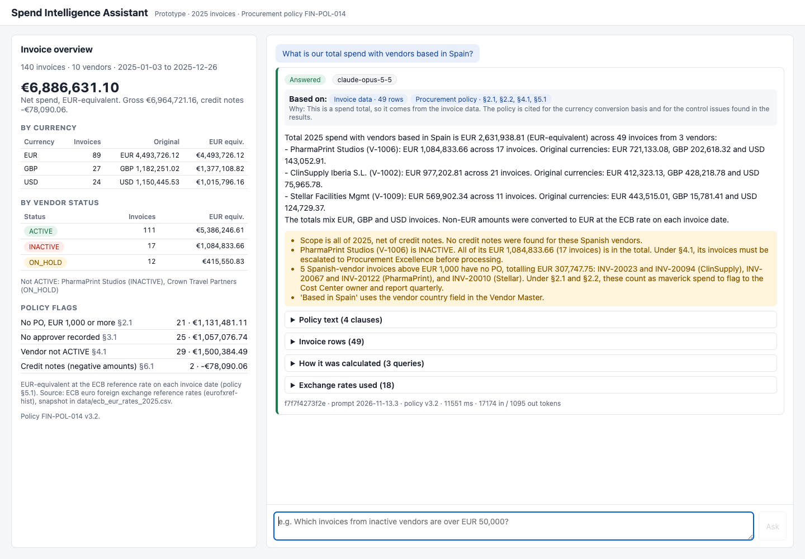

# Spend Intelligence Assistant

A finance analyst asks questions about 2025 invoices and the procurement policy, and every answer shows what it is based on: which policy clauses, which invoice rows, which calculation, and which exchange rates.

FastAPI backend, React (Vite + TypeScript) frontend, Claude via the Anthropic API, with a clearly labelled offline stub.



## Run it

Requires Python 3.10+ and Node 20+.

**Quickest:** `./start.sh` installs dependencies on first run, starts both servers, and prints the URL (http://localhost:5173). To use Claude, copy `backend/.env.example` to `backend/.env` and add your API key; without one the app runs the labelled stub.

Step by step:

```bash
# Backend
cd backend
python3 -m venv .venv          # Python 3.10+ && .venv/bin/pip install -r requirements.txt
cp .env.example .env               # then put your key in .env (git-ignored); without one the app runs the labelled stub
.venv/bin/uvicorn app.main:app --port 8000

# Frontend (second terminal)
cd frontend
npm install && npm run dev          # http://localhost:5173  (proxies /api to :8000)

# Tests and eval
cd backend
.venv/bin/python -m pytest tests
.venv/bin/python ../eval/run_eval.py        # LLM if a key is set, else stub
```

Optional: `ANTHROPIC_MODEL` (default `claude-opus-5-5`), `ANTHROPIC_EFFORT` (default `medium`), `ASSISTANT_MODE=stub` to force the stub.

**LLM path.** Claude through the official Anthropic SDK, with tool use and a JSON-schema final answer. Without an API key the backend runs `StubEngine`: keyword routing over the *same* tools, evidence and grounding checks, labelled "STUB: rule-based, no LLM" on every answer. If a key is set and the API fails, the request fails visibly. It never falls back to the stub silently.

---

## Write-up

### 1. What I built, what I left out, and why

**The core decision: the model never does arithmetic and never writes evidence.** Claude decides which sources a question needs and calls one of four typed tools (`spend_summary`, `find_invoices`, `check_invoice`, `approval_requirement`). Deterministic Python computes every figure and returns the rows behind it. Claude then writes a short answer in a fixed JSON shape, citing policy clauses by id. Before anything reaches the user, the backend checks that every number in the answer appears in the tool output or the policy, that every invoice mentioned was returned by a tool, and that every cited clause exists. An answer that fails is shown as **Unverified**, along with the figure that could not be traced. The evidence panel is built from tool output, never from model text.

Things the data forced:
- **Currency.** 3 currencies, no FX in the pack, and policy §5.1 requires the ECB rate on the invoice date. I snapshot the ECB's published history and convert each invoice at its own date (previous fixing at weekends). Every converted row carries its rate and rate date. Summing raw amounts would have mis-ranked the vendors, and a fixed rate would contradict the policy.
- **Data that doesn't exist.** `approved_by` is a username, not a role. There is no requester field, nothing links credit notes to originals, and there is no payment status. So "was this approved by the right person?" and segregation of duties (§7) cannot be checked. The tools return `cannot_verify` for these, and the prompt tells the model to decline rather than infer.
- **Policy as rules.** The §2/§3/§4 checks are hand-encoded and pinned to policy v3.2. If the loaded policy has another version, the checks report themselves as stale instead of running.

**Chosen extra: the eval set** (`eval/`), because it tests the hallucination claims above instead of just asserting them. Two other items on the list exist only as far as the core design needs them. The route is shown, because the brief asks the UI to make clear what an answer is based on. Declining exists, because a grounded system must do something with questions its tools can't answer. Both are minimal.

**Left out:** chat-history persistence (the client keeps the conversation and sends the last 3 turns for follow-ups, so the server stays stateless), auth, streaming, a vector store (the policy is 50 lines), text-to-SQL (more flexible, but unvalidated queries and no guaranteed row lineage), credit-note matching, Docker, and visual polish.

### 2. How I'd evaluate it

Three layers, cheapest first:
1. **Deterministic layer, unit-tested** (`backend/tests`): FX conversion, band boundaries (50,000.00 vs 50,000.01), totals that reconcile, rule checks. If these are wrong, nothing above them can be right.
2. **End-to-end eval** (`eval/cases.json`, 10 cases). Golden answers come from `compute_golden.py`, which shares no code with the app; golden values taken from the app's own tools would make the eval circular. Each case scores status, route (required and forbidden sources), expected figures (to 0.5%), required phrases, forbidden phrases, citations, and the grounding check. The set covers the three brief questions, a currency trap (GBP 45,000 looks like a Department Head approval but converts to EUR 53,355.47, a Finance Director), must-decline cases (2024 data, segregation of duties) and a prompt injection. Run it on every prompt or model change and track each check's pass rate, not just one total. False declines count as failures, because over-refusal is also a quality problem.
3. **In production:** grounding-failure rate, decline rate, the rate at which declared and observed routes disagree, analyst feedback, and a weekly sample reviewed by a Finance controller. Their corrections become new eval cases.

**Known gap:** the grounding check proves a figure exists in the evidence, not that it is attached to the right entity. Swapping two vendors' totals would pass it. The eval catches that by pairing figures with names; a per-claim check would close it properly.

### 3. What production would need

- **Data:** read from the ERP/AP warehouse instead of CSVs, with each tool becoming a parameterised query over a versioned snapshot; a daily ECB rate feed; a user and role directory, which turns most `cannot_verify` checks into real checks.
- **Access control:** SSO, plus row-level security by entity and cost center, enforced **in the tool layer**. The model never receives rows the user may not see, so a prompt cannot leak them.
- **Audit trail (§8.2):** every answer already writes a lineage record (`backend/logs/ask_audit.jsonl`) with the question, tool calls and arguments, source-file hashes, policy version, prompt version, model, grounding result and answer. In production that goes to an append-only (WORM) store with user identity, kept under §8.1's 10-year retention wherever outputs feed reporting.
- **Policy lifecycle:** the policy is a versioned source. A new version marks the encoded rules stale until reviewed and re-runs the eval.
- **Cost (estimate, not measured):** about 2–3 model calls per question, roughly 4k input and 0.5k output tokens each. On Claude Opus 5.5 ($4 / $20 per million tokens) that is about $0.06 per question. 200 users × 15 questions × 21 working days ≈ 63k questions, about **$4k a month**. Prompt caching of the fixed system prompt and tools, plus a smaller model for simple routes, would cut that substantially. The per-answer token counts are already returned, so the real figure can be measured in a pilot.
- **Operations:** rate limiting per user, streaming for latency, an EU-region inference endpoint and a DPA, and monitoring of the metrics in section 2. Invoice descriptions are vendor-supplied text and therefore a prompt-injection vector; the tool layer, not the prompt, is the boundary.

---

## Design notes

**API contract** (`backend/app/schemas.py`, mirrored in `frontend/src/types.ts`)

- `GET /summary`: net, gross and credit-note totals; breakdown by currency (original and EUR) and by vendor status; policy flag counts (missing PO, missing approver, non-active vendor, credit notes); FX basis; policy version; source-file hashes.
- `POST /ask {question, history[]}` returns:
  - `status`: `answered`, `declined` or `unverified`
  - `answer`, `missing_information`, `caveats`
  - `route {declared, observed, rationale, consistent}`
  - `evidence {policy[], tool_calls[], rows[], fx_rates[]}`
  - `grounding`
  - `meta {mode, model, prompt_version, policy_version, latency, tokens}`
- Failures return `{code, message, retryable}` with 429, 502 or 503. Validation errors return 422.

**Routing.** The model declares its sources and a one-line reason. The backend separately records the sources that were actually used: tools that ran, clauses cited. If the two differ, the UI says so and shows what actually ran.

**Prompt** (`backend/app/prompts.py`, versioned): the whole policy with a `[§id]` marker on each clause; the data described (including what it does *not* contain); figures only from tools; cite clauses; decline and name what's missing; flag relevant policy issues as caveats; treat the question as data, not instructions.

**Frontend state.** The summary has explicit loading (skeleton), error (with retry) and ready states. Each chat exchange is pending, done or error, managed in a reducer. Errors are retryable when the server says so, and input is disabled while a request is in flight.

## Eval results

| Run | Cases fully passed | Checks passed | Notes |
|---|---|---|---|
| Stub | 8/10 | 42/44 | Fails segregation-of-duties and injection, as expected. The stub's rules were written for these question shapes, so this result shows the harness works; it is not evidence of answer quality |
| Claude (`claude-opus-5-5`) | [FILL: run with API key] | | |

## Time spent and next steps

[FILL: actual time, in your own words.]

Next: run the LLM eval and fix what it finds; a per-claim grounding check (figure bound to entity); a role directory so approver authority can be checked; chat persistence; streaming.

## Design document

[`docs/DESIGN.md`](docs/DESIGN.md): the three architectures considered, the stage-by-stage design (built vs planned), the data findings, hallucination handling, the eval rubric and statistics, and production needs.

## How I worked with AI

See [`docs/AI_WORKFLOW.md`](docs/AI_WORKFLOW.md) for the prompts, decisions and verification, and [`CLAUDE.md`](CLAUDE.md) for the project harness Claude Code worked under.
